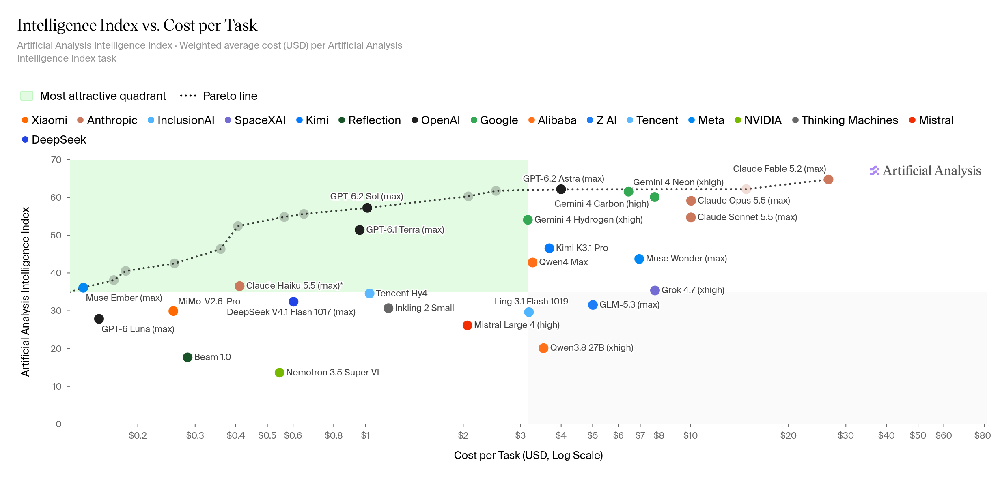
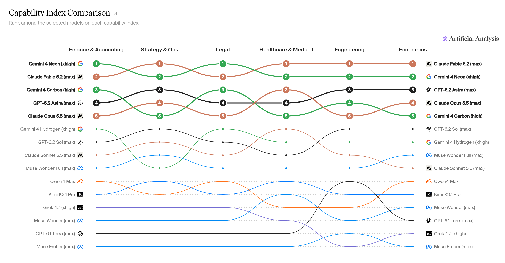

# You Have No Chance To Survive Make Your Time

<!-- chart-updated -->Captured: 2026-11-17 UTC. Intelligence Index v5.0.1.<!-- /chart-updated --> Both charts refresh daily. Click either chart to explore the latest results.

## Intelligence Index vs. Cost per Task

Source: [Artificial Analysis](https://artificialanalysis.ai/#intelligence-index-vs-cost-per-task-chart). Intelligence Index vs. weighted average cost per task (USD, logarithmic scale), including the Pareto line. Models and reasoning settings follow the source chart's default selection.

## Capability Index Comparison

Source: [Artificial Analysis](https://artificialanalysis.ai/#capability-index-comparison-chart). Ranks are relative to the selected models in each capability index. Models and reasoning settings follow the source chart's default selection.
